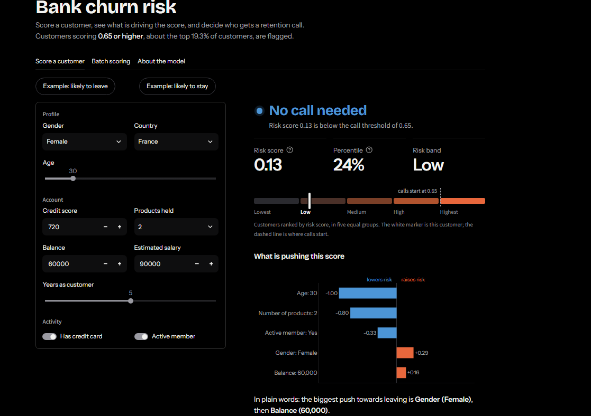
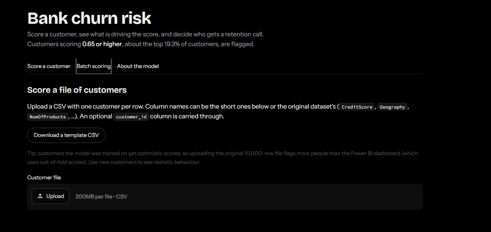
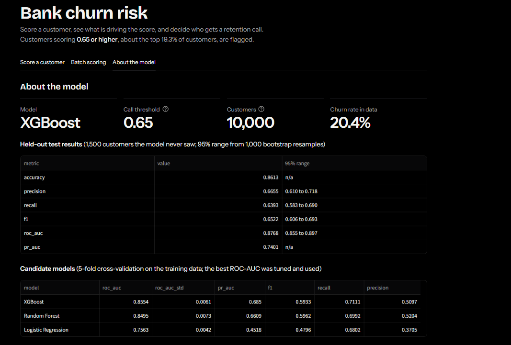
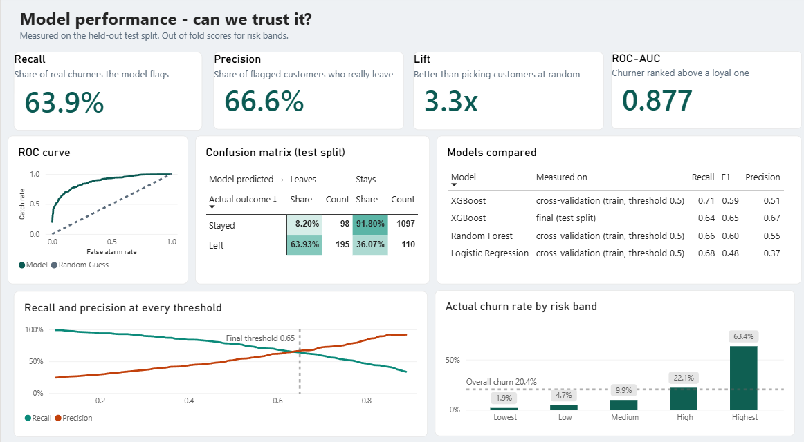
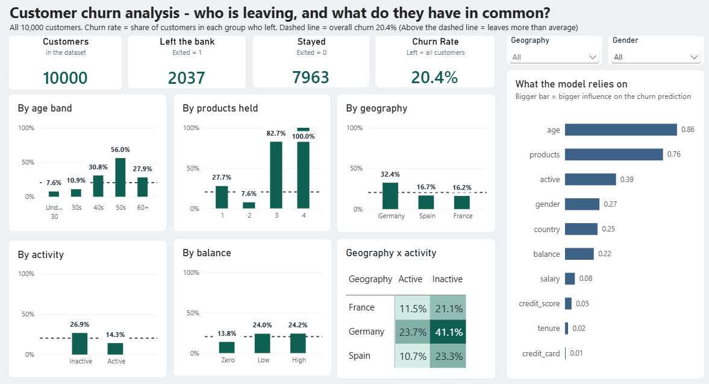
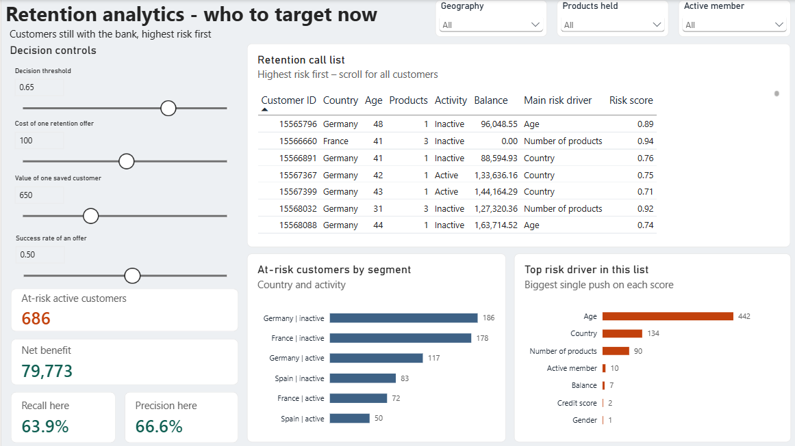

# Bank customer churn: model, API, app and dashboard

[](https://github.com/aryan2a/bank-churn-prediction/actions/workflows/ci.yml)

Find the bank customers who are most likely to leave, explain why, and give the retention team a call list.

**Live demo:** http://15.252.183.74:8520 (runs on one small AWS EC2 instance over plain HTTP, so it can be offline when the instance is stopped to save cost)

| Part | What it does | Where |
|---|---|---|
| Notebook | EDA, outlier check, model comparison, tuning, evaluation, SHAP, dashboard export | `notebooks/churn_prediction_notebook.ipynb` |
| `churn/` | Training script and the scoring code the API and app share | `python -m churn.train` |
| `api/` | FastAPI service: `/predict`, `/predict/batch`, `/model-info`, `/health` | `uvicorn api.main:app` |
| `app/` | Streamlit app: score one customer, score a CSV, read about the model | `streamlit run app/streamlit_app.py` |
| Power BI | 3-page dashboard: model performance, churn analysis, retention analytics | `dashboard/` (see its README) |
| `tests/` | 35 tests for the data checks, features, scoring, API, client and app | `pytest` |
| Docker | One image for the API, one for the app, started together with Docker Compose | `Dockerfile.api`, `Dockerfile.app`, `docker-compose.yml` |
| CI/CD | GitHub Actions: tests, Docker builds, deploy to the server on every push to `main` | `.github/workflows/ci.yml` |
| AWS | The Compose stack running on one EC2 instance | see *Deployment on AWS EC2* |

**Status:** complete: notebook, model training, API, Streamlit app, tests, Power BI dashboard, Docker, CI/CD with GitHub Actions, and a deployment on AWS EC2.

## Screenshots

**Streamlit app**



*Score a customer: verdict, score, percentile, risk band and the SHAP drivers (the "likely to stay" example is shown).*



*Batch scoring: upload a CSV, see how many customers are flagged, download the scored file.*



*About the model: held-out results with 95% bootstrap ranges, and the candidate comparison.*

**Power BI dashboard** (what each page shows is in [`dashboard/README.md`](dashboard/README.md))







## What the model does, and what it does not

- Data: the public 10,000-customer bank churn file, 20.4% of customers left.
- Model: the best of logistic regression, random forest and XGBoost by 5-fold ROC-AUC (XGBoost), tuned with grid search, then refit on train + validation and tested **once** on 1,500 held-out customers.
- Held-out results at the chosen threshold (0.65, picked on the validation set to maximise F1), from the reference run: precision 0.666 (95% range 0.610 to 0.718), recall 0.639 (0.583 to 0.690), F1 0.652, ROC-AUC 0.877 (0.855 to 0.897), accuracy 0.861. `python -m churn.train` prints your own numbers with 95% ranges, which can differ slightly with other library versions, and the app shows them on the *About the model* tab.
- The **risk score is a ranking score, not a probability.** The model is trained with class weights, so a score of 0.8 does not mean an 80% chance. Use it to order a call list.
- The **drivers** are SHAP values. They explain the model's score, not a customer's real reasons for leaving.
- Gender and country are model inputs. Check fairness and the law before any real use.
- The offer cost, value of a saved customer and success rate on dashboard page 3 are **placeholders**, not facts from this data.
- One public dataset, no time dimension: this shows the method, not how it would behave in a live bank.

## The notebook

`notebooks/churn_prediction_notebook.ipynb` is the analysis behind the project: data checks, outlier check, model comparison, tuning, threshold choice, held-out evaluation, SHAP, and (section 19) the export of the CSVs the Power BI dashboard reads. `churn/train.py` is the same recipe as a script, and it reproduces the notebook's numbers.

Run it from the `notebooks/` folder with `data/churn_raw.csv` in place (the paths are relative to that folder). It writes the dashboard CSVs to `dashboard/data/` and a notebook-only model file `notebooks/churn_model_notebook.joblib` (not the one the app uses). A full run takes about two minutes. Run all cells and save before committing, so GitHub shows the outputs.

## Run it on Windows (PowerShell)

```powershell
# 1. one-time setup (Python 3.10+)
python -m venv .venv
.venv\Scripts\Activate.ps1
pip install -r requirements.txt

# 2. put the training CSV at data\churn_raw.csv  (both column spellings work)

# 3. train (about a minute); saves models\churn_model.joblib and models\model_card.json
python -m churn.train

# 4. start the API (leave this window open)
uvicorn api.main:app --port 8000
#    docs page: http://127.0.0.1:8000/docs

# 5. in a second PowerShell window, from the same folder
.venv\Scripts\Activate.ps1
$env:API_URL = "http://127.0.0.1:8000"
streamlit run app/streamlit_app.py
#    app: http://localhost:8501
```

The app also works on its own: if you skip step 4 and the `$env:API_URL` line, it loads the model file itself. Use the API route when you want to show the full chain (app, API, model).

If you get *running scripts is disabled* when activating the venv, run `Set-ExecutionPolicy -Scope CurrentUser RemoteSigned` once.

Train options: `--data path.csv`, `--out path.joblib`, `--threshold-rule f1|cost` (the `cost` rule uses the placeholder costs in `churn/config.py`).

## API

```powershell
$body = '{"credit_score":600,"country":"Germany","gender":"Male","age":45,"tenure":3,"balance":120000,"products":1,"credit_card":true,"active":false,"salary":55000}'
Invoke-RestMethod -Uri http://127.0.0.1:8000/predict -Method Post -ContentType "application/json" -Body $body
```

```json
{
  "risk_score": 0.883,
  "flagged": true,
  "threshold": 0.65,
  "risk_percentile": 92.6,
  "risk_band": "Highest",
  "drivers": [
    {"feature": "age", "label": "Age", "value": "45", "impact": 0.7178, "direction": "raises risk"},
    {"feature": "country", "label": "Country", "value": "Germany", "impact": 0.5726, "direction": "raises risk"}
  ],
  "model_name": "XGBoost",
  "note": "The risk score ranks customers; it is not a calibrated probability, ..."
}
```

(Example output; your numbers depend on your own training run.)

| Endpoint | Purpose |
|---|---|
| `GET /health` | Is the service up and the model loaded (for health checks) |
| `GET /model-info` | Model name, threshold, held-out scores, training library versions |
| `POST /predict` | One customer in, score + flag + percentile + band + drivers out |
| `POST /predict/batch?include_drivers=true` | Up to 5,000 customers per call |

Bad input (unknown country, age 5, missing field) returns a 422 that names the field. If no model file exists, scoring endpoints return 503 with the instruction to train first.

`risk_percentile` and `risk_band` are measured against out-of-fold scores of the training customers, the same scores the Power BI dashboard uses, so a customer's band means the same thing in both places.

## The Streamlit app

1. **Score a customer**: inputs on the left; flag, score, percentile, band, gauge and the top drivers on the right. Two example buttons fill in a likely leaver and a likely stayer.
2. **Batch scoring**: upload a CSV (template provided, original dataset column names also accepted), see how many are flagged, filter by band, download all results. Customers the model was trained on get optimistic scores, so use new customers to judge behaviour.
3. **About the model**: held-out results with 95% ranges, candidate comparison, how to read the score, limits.

## Power BI dashboard

The dashboard lives in `dashboard/`, separate from the app: the `.pbix` file, the CSVs it reads, and a screenshot of each page. Open `dashboard/README.md` for what each page shows, the key numbers and the caveats (out-of-fold scores, placeholder costs).

## Tests

```powershell
pytest
```

The tests train a tiny model on synthetic customers, so they run anywhere without the real dataset. They cover input validation, feature engineering, score rounding and percentiles, every API endpoint including error cases, the app client, and the Streamlit app (rendered headlessly). GitHub Actions runs the same suite on every push (see *CI/CD* below).

## Run with Docker

Needs Docker Desktop and a trained model (`models/churn_model.joblib`, created by `python -m churn.train`). The model is **not** baked into an image and is not committed to Git: it is mounted into the API container when it starts.

```powershell
docker compose up --build
```

- API docs: http://localhost:8020/docs
- App: http://localhost:8520
- Stop: `Ctrl + C`, then `docker compose down`

| File | What it does |
|---|---|
| `Dockerfile.api` | `python:3.12-slim` plus `libgomp1` (XGBoost needs it); installs `requirements-api.txt`, copies `churn/` and `api/`, runs uvicorn as a non-root user |
| `Dockerfile.app` | A lighter image for the Streamlit app (no XGBoost or SHAP), because the app only calls the API |
| `docker-compose.yml` | Starts both, mounts `models/` read-only into the API, sets `API_URL=http://api:8000` for the app, and makes the app wait until the API health check reports that the model is loaded |
| `constraints.txt` | Pins numpy, pandas, scipy, scikit-learn, xgboost, shap and joblib to the versions the model was trained with, so a model file trained on one machine loads inside the container |
| `.dockerignore` | Keeps data, models, notebooks and dashboard files out of the images |

Host ports 8020 and 8520 are used instead of 8000 and 8501 so the containers do not clash with a locally running `uvicorn` or `streamlit`.

## CI/CD with GitHub Actions

`.github/workflows/ci.yml` runs on every push to `main` and on every pull request.

| Job | When | What it does |
|---|---|---|
| `test` | always | Installs `requirements.txt` on a clean Ubuntu runner and runs `pytest` (35 tests on synthetic data, so no dataset is needed) |
| `docker` | after `test` passes | Builds both images, so a broken Dockerfile or a missing `COPY` is caught before deployment |
| `deploy` | after `test` and `docker`, only on a push to `main` | Connects to the server over SSH, runs `git pull` and `docker compose up --build -d`, removes old images, and fails if the API health check does not answer |

The deploy job uses a dedicated SSH key stored in GitHub **Secrets** (`EC2_HOST`, `EC2_USER`, `EC2_SSH_KEY`). No key or server address is stored in the repository, and `*.pem` is in `.gitignore`.

## Deployment on AWS EC2

The same Compose stack runs on one Ubuntu 24.04 EC2 instance in the Mumbai region (ap-south-1). How it was set up:

1. Launched the instance with a security group that opens port **8520** (the app) to the internet. The API port **8020** is not opened: only the app container and the server itself can reach it.
2. Installed Docker and the Compose plugin: `sudo apt-get install -y docker.io docker-compose-v2`.
3. Cloned this repository on the server.
4. Copied the model, which is not in Git: `scp -i <key>.pem models/churn_model.joblib models/model_card.json ubuntu@<server-ip>:~/bank-churn-prediction/models/`
5. Started everything: `docker compose up --build -d`.

From then on, a push to `main` redeploys through GitHub Actions.

Trade-offs worth knowing:

- Login is key-only. Port 22 is open to the internet so that GitHub's runners can reach the server. A tighter setup would use AWS Systems Manager or a self-hosted runner.
- The app is served over plain HTTP with no domain or TLS. That is fine for a demo and not for real customer data.
- The pipeline deploys code, not models. After retraining, the new model file has to be copied to the server again.
- The live demo link is a plain IP address. It is offline while the instance is stopped, and the address changes when the instance is started again, so the link has to be updated then.

## Folder map

```
.github/workflows/   ci.yml: tests, Docker builds, deploy
notebooks/           the analysis notebook
churn/               config, data checks, features, training, prediction, SHAP explanations
api/                 FastAPI app and request/response schemas
app/                 Streamlit app, API client, look and feel (ui.py), bundled fonts (static/fonts)
tests/               pytest suite (synthetic data)
models/              churn_model.joblib + model_card.json (created by training, not committed)
data/                churn_raw.csv (not committed)
dashboard/           Power BI report (.pbix), its CSVs, page screenshots
docs/screenshots/    app screenshots shown above
Dockerfile.api  Dockerfile.app  docker-compose.yml  .dockerignore  constraints.txt
requirements.txt  requirements-api.txt  requirements-app.txt
```

## Possible next steps (not done)

A domain with HTTPS in front of the app; calibrated probabilities (the score is a ranking, not a probability); a retraining step that publishes the model to S3 so the server fetches it instead of `scp`; tighter SSH access; monitoring of input drift.

## Credits

The app's fonts, Bricolage Grotesque and Instrument Sans, are bundled in `app/static/fonts/` under the SIL Open Font License (licence files alongside).
