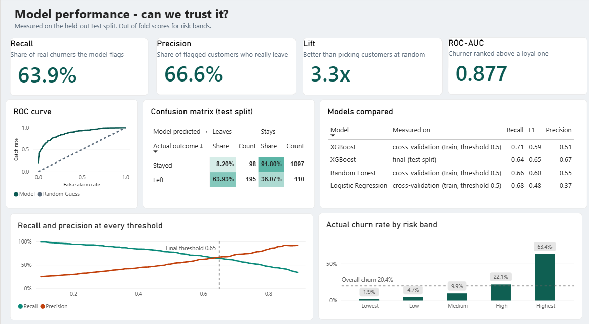
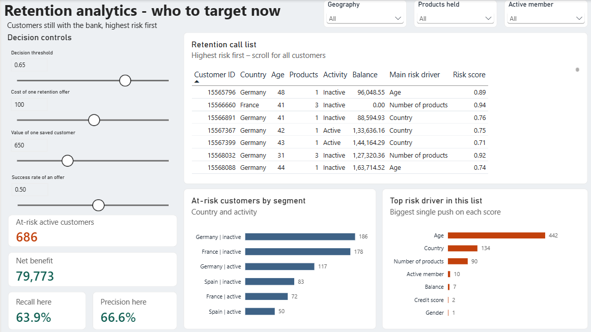

# Power BI dashboard

A 3-page Power BI report built on the model's results. It answers three questions in order: can we trust the model, who is leaving, and whom should the retention team call.

**Files in this folder**

| Path | What it is |
|---|---|
| `churnpred.pbix` | The Power BI report (open in Power BI Desktop on Windows) |
| `data/` | The CSV files the report reads, exported by the notebook (`dashboard_data`) |
| `screenshots/` | One PNG per page (below) |

## Pages

### 1. Model performance: can we trust the model?

Recall, precision, lift and ROC-AUC on the held-out test split, the ROC curve, the confusion matrix, the three models compared, recall and precision at every threshold (final threshold 0.65), and the actual churn rate in each risk band (1.9% in the lowest band to 63.4% in the highest, against 20.4% overall).

### 2. Customer churn analysis: who is leaving?

Churn rate by age band, products held, geography, activity and balance, a geography x activity heat map, and "What the model relies on" (SHAP importance), with Geography and Gender slicers. All customers: 10,000, of whom 2,037 left (20.4%). Germany alone: 2,509 customers, 814 left, 32.4%.

### 3. Retention analytics: whom do we call, and is it worth it?

Decision controls (threshold, cost of one retention offer, value of one saved customer, success rate of an offer) drive the cards, the segment chart and a ranked call list of customers who have not left yet. Geography, Products held and Active member slicers filter the list.

At the default settings (threshold 0.65, offer cost 100, value of a save 650, success rate 0.50):

| Measure | Value |
|---|---|
| At-risk customers (still with the bank, score at or above 0.65) | 686 |
| Recall at 0.65 | 63.9% |
| Precision at 0.65 | 66.6% |
| Net benefit | 79,773 |

Net benefit = expected saves x value of a save - at-risk customers x offer cost, where expected saves = at-risk customers x precision x success rate.

## Read this before quoting the numbers

- The risk scores are **out-of-fold** scores: every customer was scored by a model that never saw them. This is why the dashboard flags fewer customers than the app does when you upload the original training file.
- The offer cost, value of a saved customer and success rate are **placeholders**. This dataset has no cost data, so net benefit shows how the decision works, not a real saving. The best threshold moves when these change (with these placeholders net benefit peaks near 0.51, not 0.65).
- The notebook's test-set backtest (net benefit 1,810 at cost 1, value 10, success 0.3) is a different calculation from the dashboard's forward-looking call list. Do not compare the two numbers.

## Opening the report after cloning

Power BI remembers the folder the CSVs were loaded from. If it asks for the data on opening, go to **Home**, open the **Transform data** dropdown, then **Data source settings**, click **Change Source** for each file and point it at `dashboard/data/`.

To refresh the CSVs, run the notebook; section 19 (*Export the tables for the Power BI dashboard*) writes the `dashboard_data` folder.
